

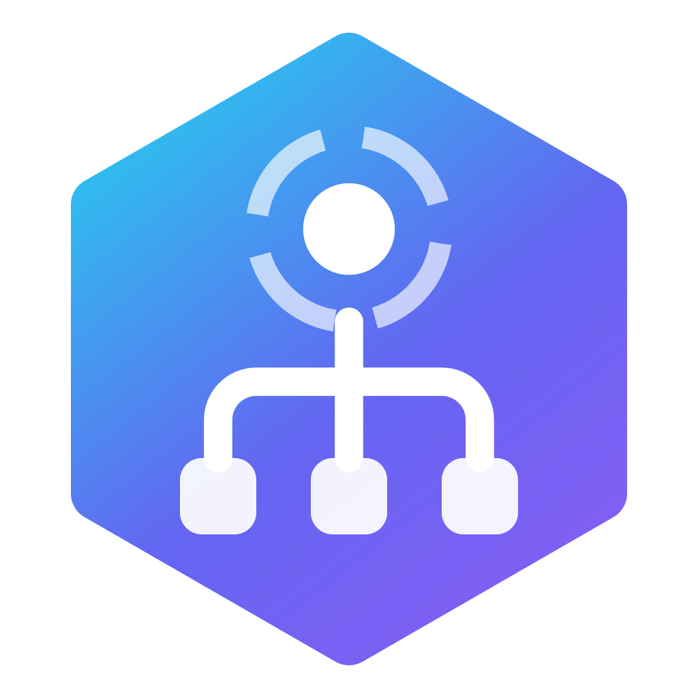

# RePID Identity

### Descubre qué hace cada proceso. Libera tu equipo desde la raíz.

Una utilidad profesional para **Windows · macOS · Linux** que identifica qué es cada proceso, lo agrupa con su aplicación, lo explica en lenguaje claro y finaliza desde la raíz a los que acaparan recursos — de forma segura y reversible.

 

### [⬇ Descargar](https://github.com/rellytechgame/repid/releases/tag/win-release) · [🌐 Demo web](https://repid-identity.vercel.app) · [💜 Apoyar el desarrollo](#-apoya-el-desarrollo) · [🐛 Reportar un error](https://github.com/rellytechgame/repid/issues/new/choose)

Creado y mantenido por 
<picture><source media="(prefers-color-scheme: dark)" srcset="brand/voxel-light.png"></picture>

> **Este es el hogar público de RePID Identity** — descargas, versiones, cambios y comunidad. El código fuente es privado. RePID es **gratis para uso personal**; las empresas usan **RePID Enterprise**.

---

## ✨ Qué hace

El Administrador de tareas te dice *que* `node.exe` o `svchost.exe` consume recursos. RePID te dice **qué es, por qué se ejecuta y cómo tratarlo** — y hace mucho más que finalizar procesos.

| | |
|---|---|
| 🧠 **Motor de identidad** | Explica cada proceso con un catálogo curado, el script que ejecuta un intérprete, los servicios que aloja, su ruta y el editor del ejecutable. |
| 🌳 **Finalización desde la raíz** | Termina la app y cada hijo que creó, empezando por el supervisor para que nada se relance — de forma ordenada y forzada solo si hace falta. |
| ✨ **Liberación inteligente** | Sugiere qué cerrar con una puntuación de impacto CPU/RAM/GPU — nunca procesos del sistema ni lo que protegiste. |
| 📊 **Actividad de disco por app** | Mira *qué* app está saturando el disco — velocidad de lectura/escritura por aplicación. |
| 🌐 **Optimizador de navegadores** | Libera la RAM que Chrome, Edge, Opera / Opera GX, Brave, Firefox y otros retienen para pestañas inactivas — bajo demanda y reversible. |
| 🚀 **Modo rendimiento** | Haz que las apps en segundo plano cedan CPU con EcoQoS de Windows 11; prioriza lo que estás usando. No se cierra nada. |
| ⏱️ **Modo automático y reglas** | Acelera juegos solo, limpia lo seguro con programación y aplica reglas ("libera la RAM de Chrome al pasar de 4 GB"). |
| ⏻ **Programas de inicio** | Todo lo que abre al iniciar sesión, con su impacto real medido — deshabilita de forma reversible. |
| 🧩 **Servicios de Windows** | Servicios curados que pueden iniciarse cuando hacen falta en vez de al arrancar — pasan a Manual, nunca se deshabilitan. |
| 📦 **Desinstalador inteligente** | Ejecuta el desinstalador de la app y elimina lo que dejó, incluidos rastros de apps que ya desinstalaste. |
| 🧹 **Limpieza y mapa de disco** | Temporales, cachés, datos de navegadores, volcados, Windows.old; un mapa de qué llena tu disco, archivos grandes y duplicados reales. |
| 🩺 **Salud e informe** | Estado de discos, batería, temperaturas y espacio, más un informe del sistema para compartir con un clic. |
| 🛡️ **Red de seguridad** | Protección en tres niveles (Protegido / Precaución / Seguro) aplicada dentro del motor y verificada antes de cada acción. |
| 🧩 **Integración con el escritorio** | Widget flotante, menú de bandeja, Jump List de Windows, menú del Dock y menú contextual del Explorador. |
| 🔒 **100% local** | Sin cuentas, sin telemetría, sin servidores. Solo una comprobación anónima opcional de versión nueva. |

## 📸 Capturas

| Entiende qué hace un proceso | Liberación inteligente |
|:---:|:---:|
| 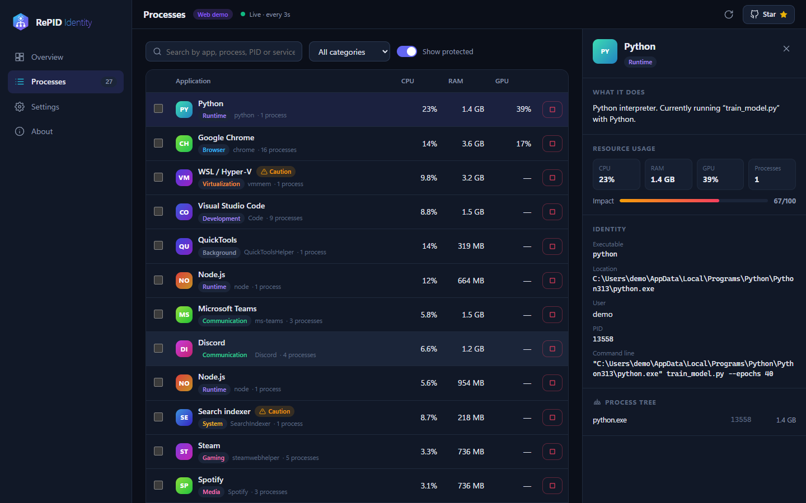 | 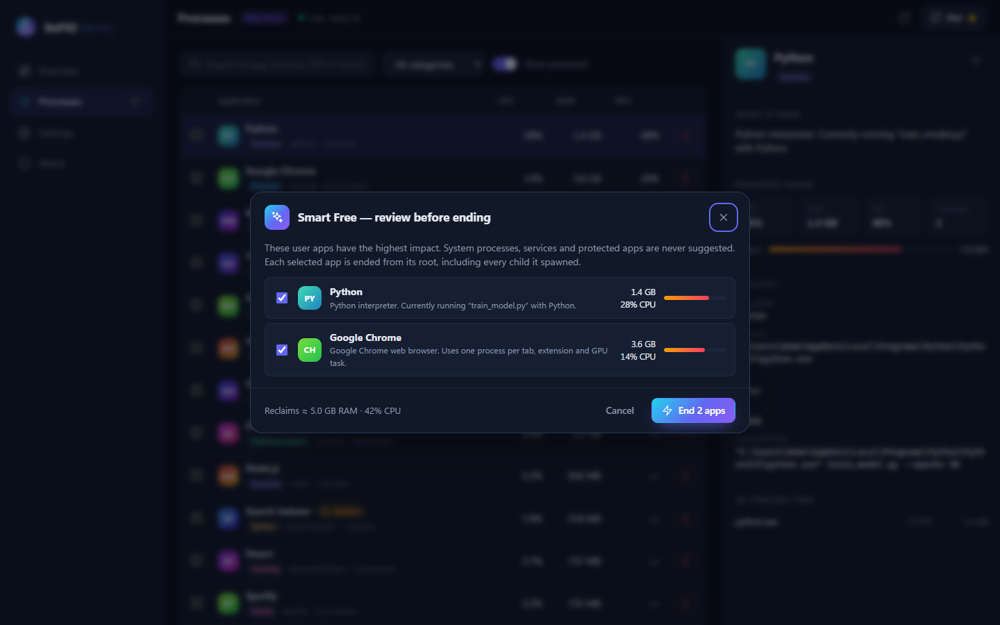 |
| **Modo rendimiento** | **Modo automático y reglas** |
| 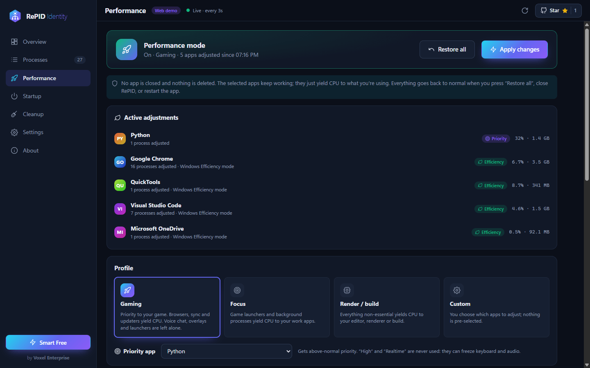 | 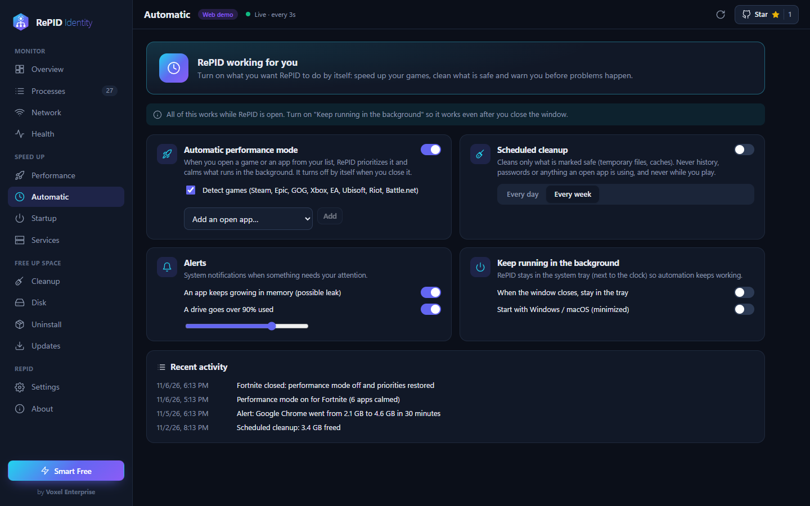 |
| **Mapa del disco** | **Salud, en lenguaje claro** |
| 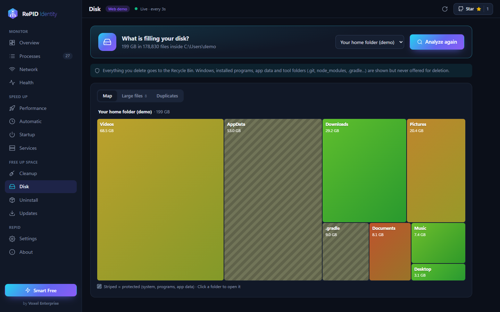 | 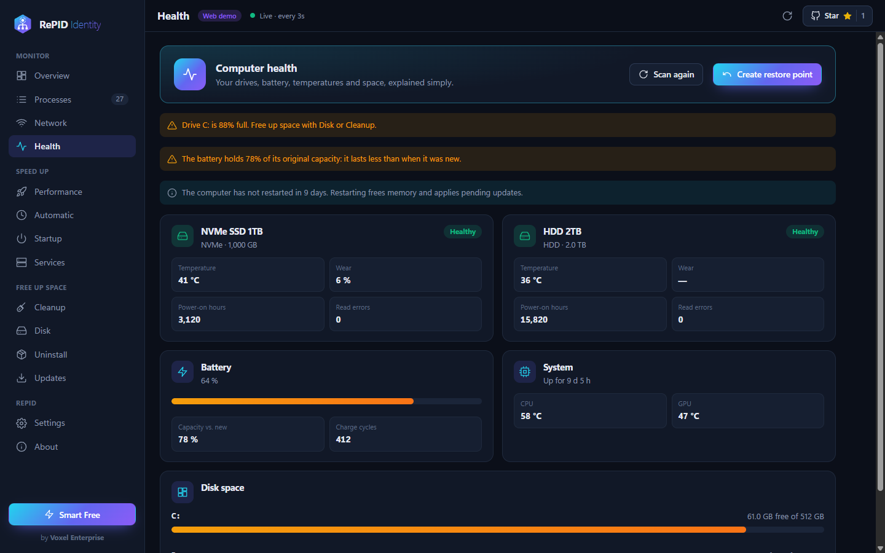 |
| **Desinstalador inteligente** | **Limpieza profunda** |
| 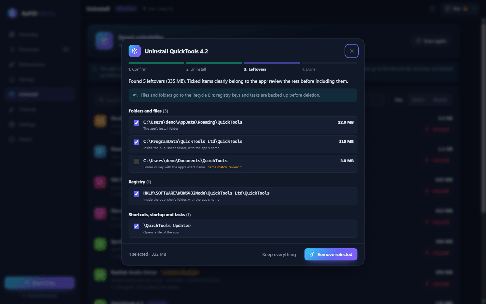 | 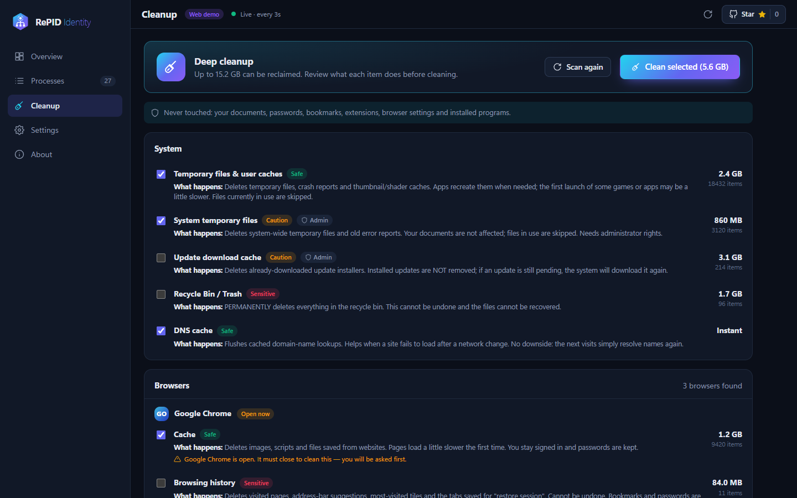 |
| **Quién usa tu red** | **Programas de inicio** |
| 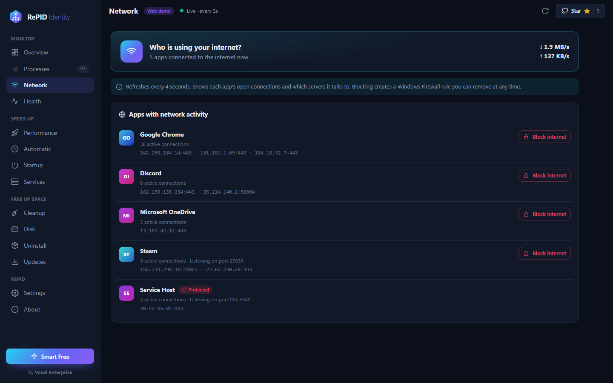 | 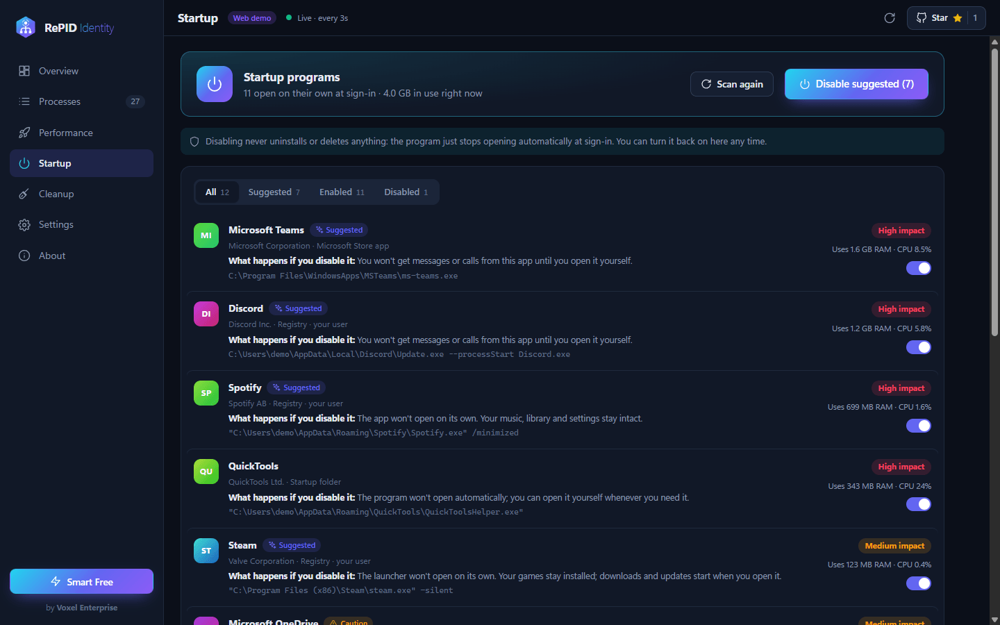 |

## ⬇ Descarga

Toma el instalador de tu sistema desde la [**última versión**](https://github.com/rellytechgame/repid/releases/tag/win-release):

| Sistema | Notas |
|---|---|
| **Windows 10/11** | Instalador y portable (x64 / ARM64). Pide permisos de administrador para finalizar procesos, detener servicios y limpiar carpetas del sistema. |
| **macOS 12+** | Apple Silicon e Intel (`.dmg`). |
| **Linux** | AppImage, deb, rpm. |

> Hasta financiar los certificados de firma, Windows SmartScreen y macOS Gatekeeper pueden advertir al abrir por primera vez. [Ayuda a financiar la firma →](#-apoya-el-desarrollo)

## 🌍 Idiomas

RePID viene totalmente traducido en:

| | Idioma | App | Web |
|---|---|:---:|:---:|
| 🇪🇸 | **Español** (principal) | ✅ | ✅ |
| 🇬🇧 | **English** | ✅ | ✅ |

**¿Quieres RePID en tu idioma?** Cada idioma es un solo archivo de textos cortos — [abre una solicitud de traducción](https://github.com/rellytechgame/repid/issues/new/choose) y lo agregamos con tu crédito. Mira la [guía de traducción](docs/ADDING_A_LANGUAGE.md) para el formato.

## 💼 Ediciones

RePID es **gratis para personas** bajo la [Licencia PolyForm Noncommercial](LICENSE).

| | Gratis | **RePID Enterprise** |
|---|:---:|:---:|
| Todas las funciones | ✅ | ✅ |
| Uso personal | ✅ | ✅ |
| Uso en empresa / comercial | — | ✅ |
| Equipos ilimitados por red | — | ✅ |
| Soporte directo de Voxel Enterprise | — | ✅ |
| Acceso anticipado a versiones Beta | — | ✅ |
| Precio | **$0** | **$20 USD / equipo / año** |

Soporte Enterprise: `soporte@voxel.lat` · `support@voxel.lat`

## 💜 Apoya el desarrollo

RePID lo crea y mantiene un solo desarrollador en **Voxel Enterprise**. Mantenerlo gratis para las personas y financiar certificados de firma, alojamiento y nuevas funciones cuesta recursos reales. Si RePID te sirve, así puedes ayudar:

- ⭐ **[Dale una estrella a este repo](https://github.com/rellytechgame/repid)** — es gratis y ayuda de verdad a que RePID llegue a más gente.
- ☕ **[Patrocina o dona con PayPal](https://paypal.me/iandasystems)** — cualquier monto financia certificados y desarrollo. Usa el botón **Sponsor** arriba.
- 💼 **[Obtén RePID Enterprise](https://www.paypal.com/cgi-bin/webscr?cmd=_s-xclick&hosted_button_id=YGXL925PT8524)** si tu empresa lo usa — la forma más justa de mantener vivo el proyecto.
- 🗣️ **Corre la voz, reporta errores y sugiere funciones** (abajo).

## 🤝 Contribuir

El código fuente es privado, así que no se aceptan *pull requests* de código — pero tus aportes dan forma a RePID y son muy bienvenidos:

- 🐛 **[Reporta un error](https://github.com/rellytechgame/repid/issues/new/choose)** — incluye tu sistema y los pasos.
- 💡 **[Pide una función](https://github.com/rellytechgame/repid/issues/new/choose)** — cuéntanos qué haría a RePID indispensable para ti.
- 🌐 **Ayuda a traducir** — mira [Idiomas](#-idiomas).

Mira [CONTRIBUTING.md](CONTRIBUTING.md) y nuestra [política de seguridad](SECURITY.md).

## 🔒 Privacidad

RePID no hace peticiones de red propias salvo llamadas anónimas a la API pública de GitHub (el contador de estrellas y una comprobación opcional de versión nueva). No se envía nada tuyo ni de tu equipo.

## 📄 Licencia y autor

Creado y propiedad de **RellyDev — Voxel Enterprise**. Doble licencia: gratis para uso no comercial bajo la [**Licencia PolyForm Noncommercial 1.0.0**](LICENSE); el uso en empresas requiere licencia comercial (RePID Enterprise). El aviso de autoría debe conservarse en todas las copias. © 2026 RellyDev — Voxel Enterprise.

 
<picture><source media="(prefers-color-scheme: dark)" srcset="brand/voxel-light.png"></picture>
  
<strong>Si RePID te sirve, una ⭐ ayuda muchísimo.</strong>

