

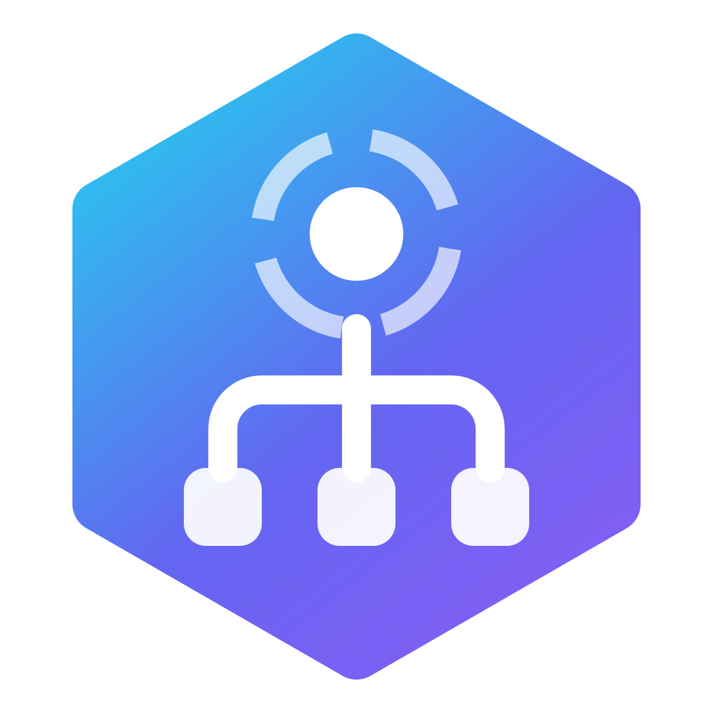

# RePID Identity

### Know what every process really does. Free your computer from the root.

A professional system utility for **Windows · macOS · Linux** that identifies what each process is, groups it with the app it belongs to, explains it in plain language, and ends resource hogs from the root — safely and reversibly.

 

### [⬇ Download](https://github.com/rellytechgame/repid/releases/tag/win-release) · [🌐 Live web demo](https://repid-identity.vercel.app) · [💜 Support development](#-support-the-development) · [🐛 Report a bug](https://github.com/rellytechgame/repid/issues/new/choose)

Created and maintained by 
<picture><source media="(prefers-color-scheme: dark)" srcset="brand/voxel-light.png"></picture>

> **This is the public home of RePID Identity** — downloads, releases, changelog and community. The source code is private. RePID is **free for personal use**; companies use **RePID Enterprise**.

---

## ✨ What it does

Task Manager tells you *that* `node.exe` or `svchost.exe` is using resources. RePID tells you **what it is, why it's running, and how to deal with it** — and it does far more than end processes.

| | |
|---|---|
| 🧠 **Identity engine** | Explains every process from a curated catalog, the script an interpreter runs, hosted services, install location and the executable's own publisher. |
| 🌳 **Root-level termination** | Ends an app and every child it spawned, supervisor first so nothing respawns — gracefully, then forced only if needed. |
| ✨ **Smart Free** | Suggests what to close by a CPU/RAM/GPU impact score — never system processes or anything you protected. |
| 📊 **Per-app disk activity** | See *which* app is pushing the disk to 100% — read/write rate per application. |
| 🌐 **Browser optimizer** | Frees the RAM Chrome, Edge, Opera / Opera GX, Brave, Firefox and others hold for idle tabs — on demand, reversible. |
| 🚀 **Performance mode** | Make background apps yield CPU with Windows 11 EcoQoS; prioritize the app you're using. Nothing is closed. |
| ⏱️ **Automatic mode & rules** | Boosts games automatically, cleans safe junk on a schedule, and runs watchdog rules ("free Chrome's RAM over 4 GB"). |
| ⏻ **Startup manager** | Every program that opens at sign-in, with its real measured impact — disable reversibly. |
| 🧩 **Windows services** | Curated services that can start on demand instead of at boot — switched to Manual, never disabled. |
| 📦 **Smart uninstaller** | Runs the app's own uninstaller, then removes what it left behind, including leftovers of apps you already uninstalled. |
| 🧹 **Deep cleanup & disk map** | Temp, caches, browser data, crash dumps, Windows.old; a treemap of what fills your disk, big files and real duplicates. |
| 🩺 **Health & report** | Drive health, battery, temperatures and space, plus a one-click shareable system report. |
| 🛡️ **Safety net** | Three-tier protection (Protected / Caution / Safe) enforced inside the engine, re-checked before every action. |
| 🧩 **Desktop integration** | Floating widget, rich tray menu, Windows jump list, macOS dock menu and Explorer context menu. |
| 🔒 **100% local** | No accounts, no telemetry, no servers. Only an optional anonymous check for a new version. |

## 📸 Screenshots

| Understand what a process does | Smart Free suggestions |
|:---:|:---:|
| 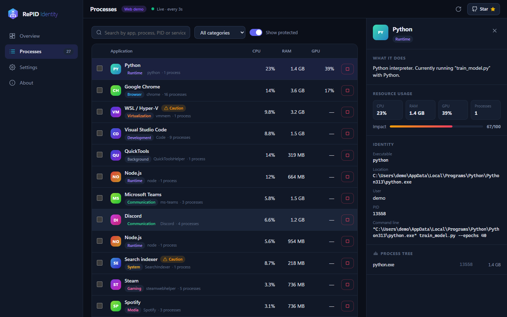 | 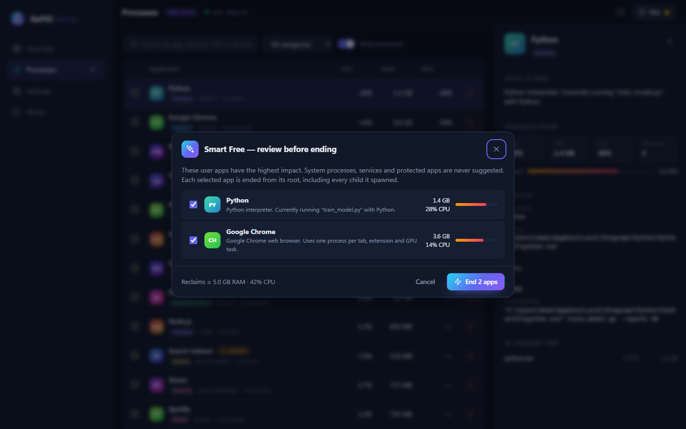 |
| **Performance mode** | **Automatic mode & watchdog rules** |
| 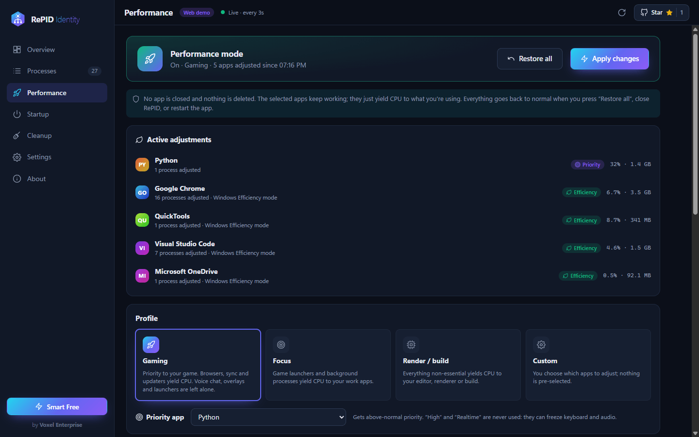 | 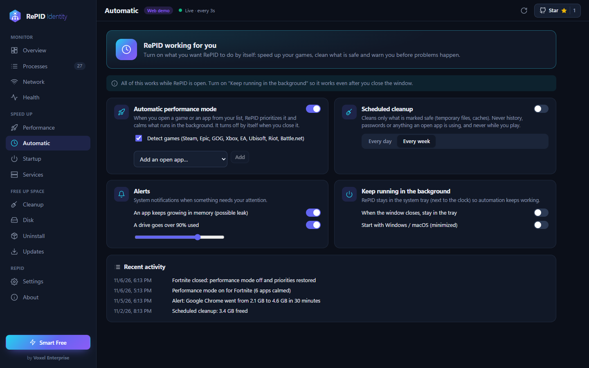 |
| **Disk map: what fills your disk** | **Health, in plain language** |
| 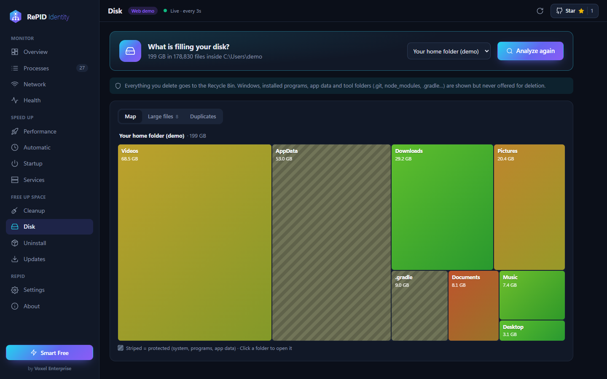 | 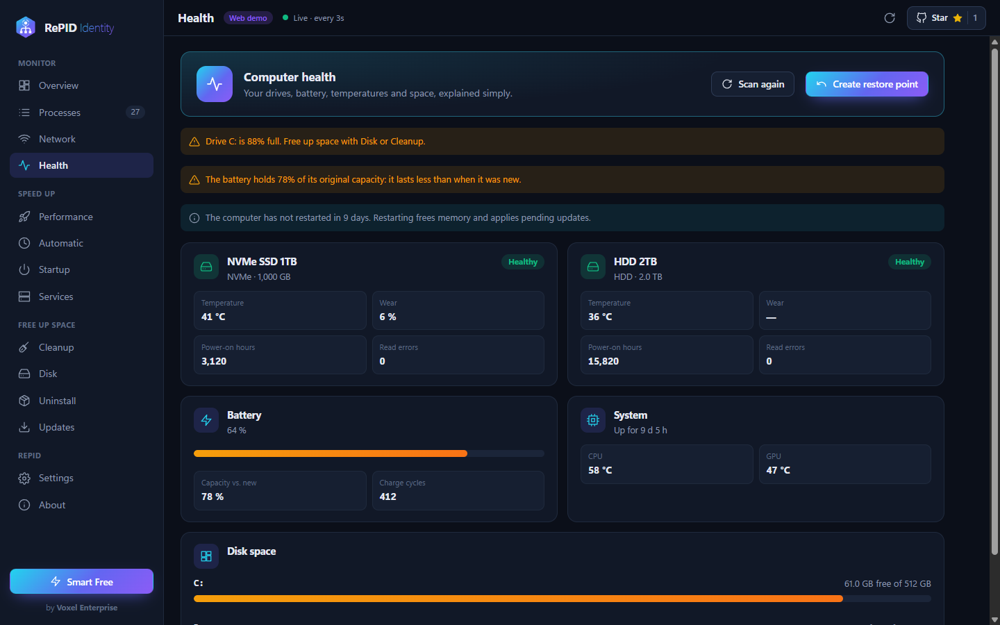 |
| **Smart uninstaller** | **Deep cleanup** |
| 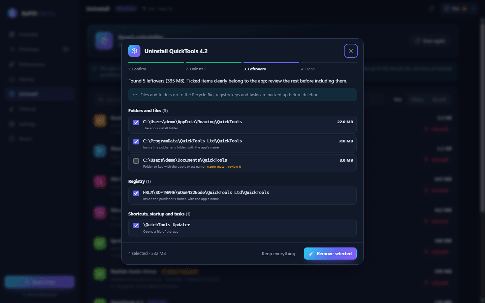 | 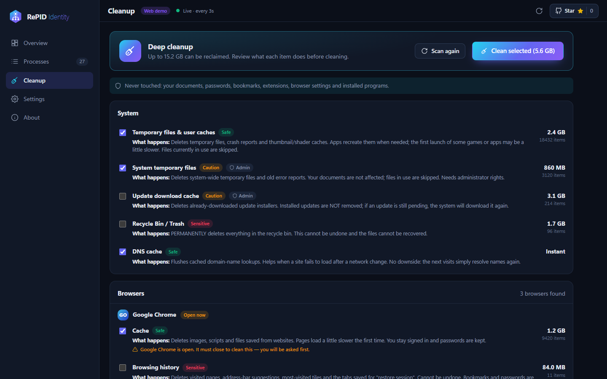 |
| **Who's using your network** | **Startup manager** |
| 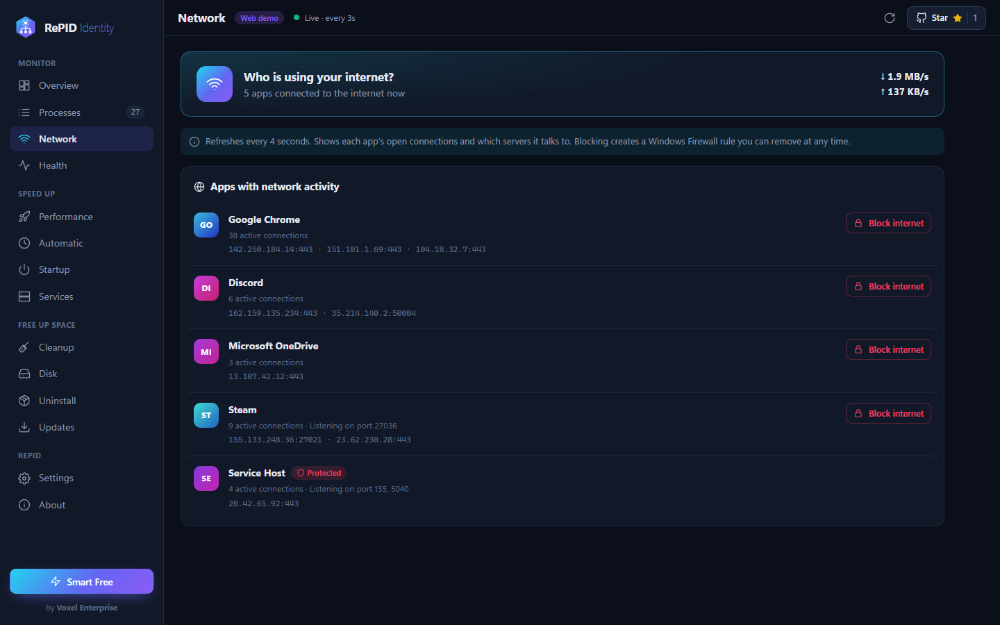 | 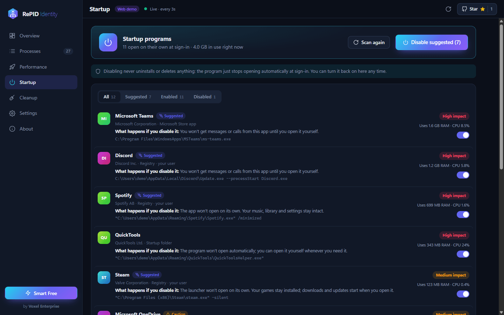 |

## ⬇ Download

Grab the installer for your system from the [**latest release**](https://github.com/rellytechgame/repid/releases/tag/win-release):

| OS | Notes |
|---|---|
| **Windows 10/11** | Installer and portable (x64 / ARM64). Requests administrator rights so it can end any process, stop services and clean system folders. |
| **macOS 12+** | Apple Silicon and Intel (`.dmg`). |
| **Linux** | AppImage, deb, rpm. |

> Until code-signing certificates are funded, Windows SmartScreen and macOS Gatekeeper may warn on first launch. [Help fund signing →](#-support-the-development)

## 🌍 Languages

RePID ships fully translated in:

| | Language | App | Website |
|---|---|:---:|:---:|
| 🇪🇸 | **Español** (primary) | ✅ | ✅ |
| 🇬🇧 | **English** | ✅ | ✅ |

**Want RePID in your language?** Each language is a single file of short texts — [open a translation request](https://github.com/rellytechgame/repid/issues/new/choose) and we'll add it with your credit. See the [translation guide](docs/ADDING_A_LANGUAGE.md) for the format.

## 💼 Editions

RePID is **free for individuals** under the [PolyForm Noncommercial License](LICENSE).

| | Free | **RePID Enterprise** |
|---|:---:|:---:|
| Every feature | ✅ | ✅ |
| Personal use | ✅ | ✅ |
| Company / commercial use | — | ✅ |
| Unlimited computers per network | — | ✅ |
| Direct support from Voxel Enterprise | — | ✅ |
| Early access to Beta versions | — | ✅ |
| Price | **$0** | **$20 USD / computer / year** |

Enterprise support: `support@voxel.lat` · `soporte@voxel.lat`

## 💜 Support the development

RePID is built and maintained by one developer at **Voxel Enterprise**. Keeping it free for individuals and funding code-signing certificates, hosting and new features takes real resources. If RePID helps you, here's how to help back:

- ⭐ **[Star this repository](https://github.com/rellytechgame/repid)** — it's free and genuinely helps RePID reach more people.
- ☕ **[Sponsor / donate via PayPal](https://paypal.me/iandasystems)** — any amount funds signing certificates and development. Use the **Sponsor** button at the top of this repo.
- 💼 **[Get RePID Enterprise](https://www.paypal.com/cgi-bin/webscr?cmd=_s-xclick&hosted_button_id=YGXL925PT8524)** if your company uses it — the fairest way to keep the project alive.
- 🗣️ **Spread the word, report bugs and suggest features** (below).

## 🤝 Contributing

The source code is private, so code pull requests aren't accepted — but your input shapes RePID and is very welcome:

- 🐛 **[Report a bug](https://github.com/rellytechgame/repid/issues/new/choose)** — include your OS and steps.
- 💡 **[Request a feature](https://github.com/rellytechgame/repid/issues/new/choose)** — tell us what would make RePID indispensable for you.
- 🌐 **Help translate** — see [Languages](#-languages).

See [CONTRIBUTING.md](CONTRIBUTING.md) and our [security policy](SECURITY.md).

## 🔒 Privacy

RePID makes no network requests of its own except anonymous calls to the public GitHub API (the star count and an optional new-version check). Nothing about you or your computer is ever sent.

## 📄 License & author

Created and owned by **RellyDev — Voxel Enterprise**. Dual-licensed: free for noncommercial use under the [**PolyForm Noncommercial License 1.0.0**](LICENSE); company use requires a paid commercial license (RePID Enterprise). The authorship notice must be preserved in all copies. © 2026 RellyDev — Voxel Enterprise.

 
<picture><source media="(prefers-color-scheme: dark)" srcset="brand/voxel-light.png"></picture>
  
<strong>If RePID helps you, a ⭐ goes a long way.</strong>

